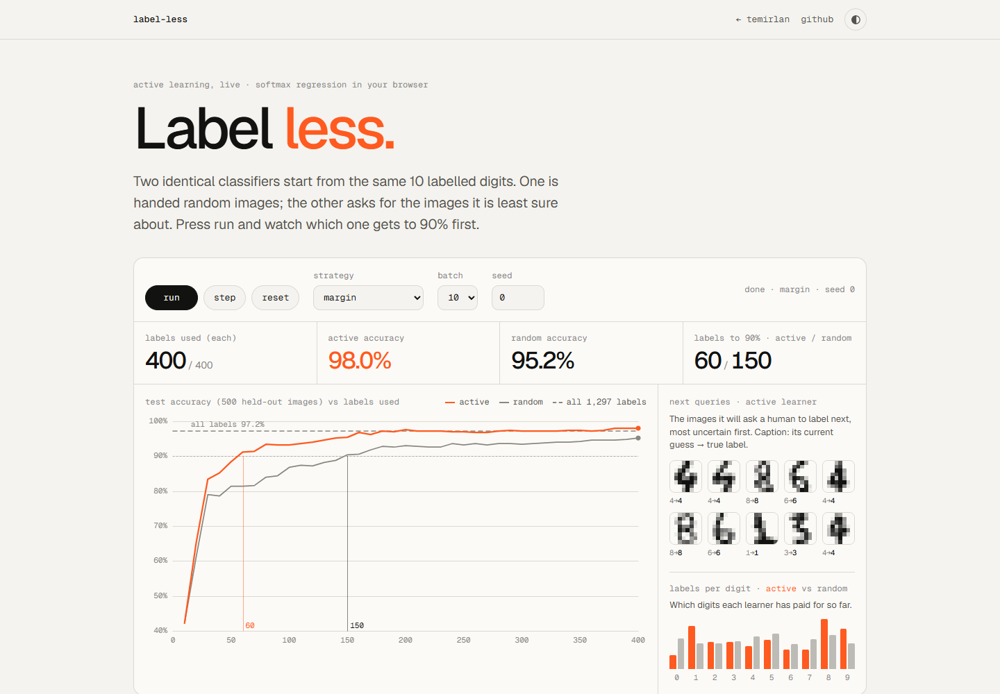

# Label Less — active learning, live

Two identical classifiers start from the same 10 labelled digits. One is handed random images, the other asks for the images it is least sure about — and gets to 90% accuracy with about half the labels.

**Live demo:** https://temirlanzzz.github.io/label-less/



## How it works

- **Data:** the UCI optical digits set (sklearn `load_digits`), 1,797 handwritten digits at 8×8, exported to `digits.json` by `tools/export_digits.py`. It is split once (fixed shuffle) into a **1,297-image unlabelled pool** and a **fixed 500-image test set**.
- **Model:** softmax regression (64 pixels + bias → 10 classes), written from scratch in `al.js`. Full-batch gradient descent with Nesterov momentum and light L2, 300 iterations, retrained from zero after every batch.
- **Learners:** both start from the same 10 random labels (picked by the seed). Each round, the random learner takes the next batch from a shuffled pool; the active learner scores every unlabelled image and asks for the most uncertain ones:
  - **margin** — smallest gap between the top two class probabilities (default)
  - **entropy** — highest entropy of the predicted distribution
  - **least-confident** — lowest top probability
- **Oracle:** simulated — it reveals the ground-truth label.
- **UI:** run / pause / step / reset, strategy, batch size and seed; a hand-drawn canvas chart of test accuracy vs labels (active, random, dashed all-labels line); a grid of the 8×8 images the active learner will query next; stat tiles; per-digit label counts. No dependencies, no build step.

## Results

`bench()` in `al.js`, run via `bench.html?s=margin,entropy,least` in headless Chrome 155. 5 seeds (0–4), batch of 10, up to 400 labels, scored on the fixed 500-image test set. Raw output: [`results/bench-chrome.json`](results/bench-chrome.json).

| metric (5 seeds)          | active · margin       | random                        |
|---------------------------|-----------------------|-------------------------------|
| labels to reach 90%       | **66** avg (60–80)    | 126 avg (100–150)             |
| accuracy at 100 labels    | **92.9%**             | 88.6%                         |
| accuracy at 200 labels    | **97.3%**             | 93.0%                         |
| labels to reach 95%       | **110–160**           | 230–400 (one seed never, ≤400)|
| accuracy at 400 labels    | **98.0%**             | 95.2%                         |

| strategy        | labels to 90%  | at 100 labels | at 200 labels |
|-----------------|----------------|---------------|---------------|
| margin          | 66 (60–80)     | 92.9%         | 97.3%         |
| least-confident | 98 (90–110)    | 90.7%         | 96.8%         |
| entropy         | 116 (110–120)  | 88.2%         | 94.8%         |
| random          | 126 (100–150)  | 88.6%         | 93.0%         |

All 1,297 pool labels: **97.2%** test accuracy (1,500 iterations; 97.4% at 300).

### What I learned

- **Uncertainty sampling is not a free win.** Entropy sampling was worse than random on two of five seeds (120 vs 100 labels to 90%) and on average at 100 labels. With 10 labels the model's probabilities are poorly calibrated, and entropy over all ten classes favours vaguely confusing images over ones near a real decision boundary.
- **Margin was the most reliable**, beating random on every seed, so it is the default.
- **Check the baseline before comparing.** I trained the all-labels model to 1,500 iterations to make sure it was not undertrained; with momentum it had already converged by 300 (97.4% vs 97.2%), so the comparison is fair — but I only know that because I measured it.
- **"Beats all labels" is mostly noise.** 98.0% at 400 active labels vs 97.2% for all labels is a 4-image difference on a 500-image test set. I would not claim it.

## Run locally

```sh
python -m http.server 8000
# open http://localhost:8000/            the demo
# open http://localhost:8000/bench.html?s=margin,entropy,least   re-run the benchmark (~2 min)
```

`fetch` needs a server, so opening `index.html` from disk will not load the data. To regenerate the dataset: `pip install scikit-learn && python tools/export_digits.py`.

## Project structure

```
index.html              page + write-up
style.css               design tokens (light/dark), layout
al.js                   softmax regression, uncertainty strategies, Learner, bench()
app.js                  controls, canvas chart, query grid, tiles
bench.html              runs bench() and prints JSON
digits.json             UCI optical digits (1,797 × 8×8), compact string encoding
tools/export_digits.py  dumps sklearn load_digits to digits.json
results/bench-chrome.json  raw benchmark output
docs/screenshot.png
```

## Limits

- Toy dataset: 8×8 digits are small, clean and balanced.
- Linear model: cheap to retrain each round; deep models have worse-calibrated uncertainty and expensive retraining.
- Simulated oracle using ground-truth labels; a real annotator is slower and noisier on exactly the ambiguous images uncertainty sampling picks.
- Five seeds — enough to see the gap, not enough for tight error bars.

## License

MIT — see [LICENSE](LICENSE).
